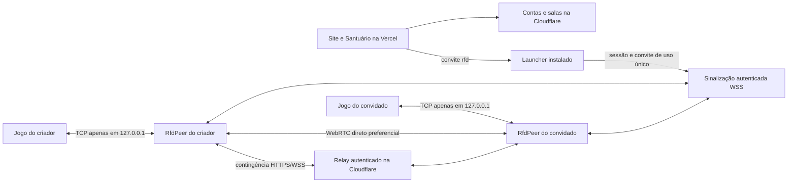
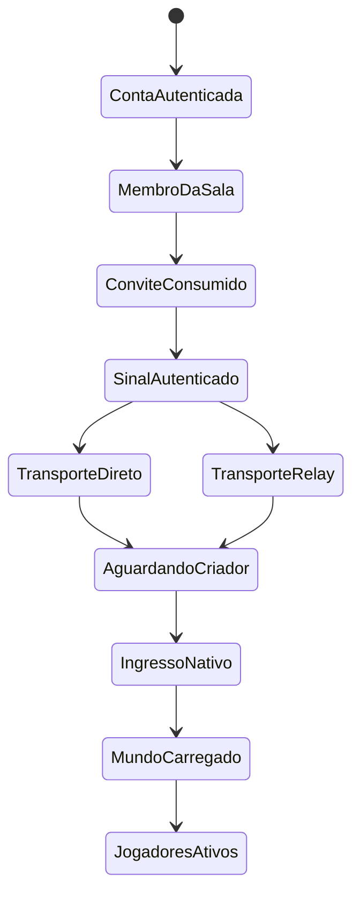

# Auditoria do multiplayer — Returns from Darkness HD 0.4.7

## Resultado e limite da conclusão

Foram reproduzidas falhas na versão pública 0.4.6 e corrigidas a preparação da partida, a transferência local de conta e sala, a saída pelo site e a recuperação de uma conexão encerrada. Cadastro e associação a uma sala não comprovam que o mundo do jogo foi carregado com outros jogadores.

Os testes foram executados neste computador, com perfis isolados, executáveis de produção e o serviço público na nuvem; alguns testes usam uma build privada com instrumentos de verificação. Há testes sem candidatos diretos de rede, com retransmissão HTTPS, atraso artificial, criador atrasado e retorno à sala. **Não foi usada uma segunda máquina externa. A partida gráfica entre PCs em redes diferentes ainda precisa de confirmação real.** Não é possível atribuir com certeza a falha do primeiro jogador a uma causa específica sem observar aquela execução.

## Como a conexão funciona hoje

1. O site e o menu interno autenticam a mesma conta no serviço de comunidade. O site usa a rota de API do próprio domínio; o cliente Windows usa a API HTTPS da comunidade.
2. Criar ou entrar em uma sala reserva um lugar. O criador ocupa o lugar 0; os convidados ocupam 1–3. A sala define modo, dificuldade, versão de conteúdo e semente do mundo.
3. O site emite um convite de entrada e um código de transferência de sessão. Os códigos são temporários e de uso único. O launcher mantém a sessão local protegida pelo Windows, separada por conta.
4. O launcher verifica o pacote assinado, prepara os dados e inicia o RfdPeer. O bootstrap consome o convite e emite uma autorização para a sinalização daquela conta e lugar.
5. A sinalização WSS troca descrições e candidatos ICE. O caminho preferencial é WebRTC com DTLS/SCTP, confiável e ordenado. O criador se comunica com cada convidado; encaminha o tráfego necessário aos demais.
6. Quando a conexão direta não é estabelecida, o convidado solicita retransmissão autenticada pela Cloudflare. A solicitação começa após cerca de oito segundos e é repetida a cada dois segundos até haver transporte ou ocorrer timeout. Isso cobre redes que não permitem o caminho direto, desde que a conexão HTTPS/WSS de saída esteja disponível.
7. O criador pode abrir seu jogo após autenticar a ponte. O convidado só recebe a indicação de entrada pronta quando há transporte **e** o jogo do criador já confirmou seu ingresso no protocolo de mundo. O indicador é um handshake de entrada; não equivale sozinho a terminar todos os passos de carregamento gráfico.
8. O jogo fala com a própria ponte por uma porta TCP efêmera em `127.0.0.1`, usando uma credencial local. Essa porta não é o endereço do outro jogador e não deve ser aberta no roteador.
9. A engine mantém o mundo por comandos e turnos sincronizados. A confirmação mais forte usada nesta auditoria é dois jogadores ativos na engine, com estados compartilhados e teste de troca de salas.

O projeto **não precisa de um servidor de jogo dedicado no PC do administrador** para esse modelo. Ele continua dependendo dos serviços na nuvem para contas, descoberta, preparação e, quando necessário, retransmissão. O cliente do criador mantém a partida e precisa ficar conectado. A porta 25565 do escopo antigo não participa deste transporte moderno.

## O que foi reproduzido e corrigido

| Falha | Evidência | Correção |
|---|---|---|
| Convidado abre antes do criador | O RfdPeer publicado da 0.4.6 solicitava relay uma vez; com o criador abrindo 20 segundos depois, o convidado expirava sem entrar | Repetição da solicitação, autenticação explícita antes de liberar a ponte e espera pela entrada do criador |
| Transporte pronto enquanto o criador ainda escolhe personagem | A conexão da ponte podia ser considerada pronta antes de haver handshake nativo do criador | Estado `waiting-host`, notificação de prontidão e espera limitada com mensagem própria no launcher |
| Conta/sala em perfil Windows com caracteres especiais | A 0.4.6 rejeitou a transferência de conta em uma instalação isolada sob `João-日本`; caminhos ANSI do executável também prejudicavam a inicialização | Validação Unicode da transferência, arquivos de sessão com caminhos amplos e caminhos compatíveis para o núcleo antigo quando o NTFS fornece aliases |
| Sair pelo site e voltar ao mesmo lugar | A associação mudava, mas o criador conservava o estado da ligação anterior no relay | Revogação da autorização antiga, notificação `peer-left` e limpeza de filas, flags e callbacks por geração |
| Conexão fechada escolhida para encaminhamento | A busca por sockets podia selecionar um socket em encerramento | Somente sockets abertos participam de autenticação, encaminhamento e notificações |
| Botão retoma uma conexão local morta | A central podia devolver `resume` para uma ligação que o launcher já havia perdido | O próprio launcher autenticado solicita um convite novo; a preparação não faz uma chamada circular entre objetos do serviço |
| Diagnóstico indica conectado sem partida | A ponte reportava transporte, mas não distinguia claramente autenticação, espera e ingresso nativo | Fases de entrada, transporte por ligação, handshake e contador real de jogadores nos testes |

O suporte ao núcleo legado não constitui uma migração completa para Unicode de todo o jogo. Caminhos sem aliases NTFS e com caracteres não representáveis pela página de códigos local ainda exigem teste específico. Não se deve dizer que qualquer nome de pasta está certificado.

## Estados que não devem ser confundidos

O estado da sala no site deriva do relato do criador ao serviço. Ele não substitui a observação da engine. Um único cliente mostrar Tristram também não comprova que os outros terminaram o ingresso.

## Desempenho e sincronização

O transporte direto evita a passagem dos comandos pelo relay quando a rede permite. A conexão confiável e ordenada entrega os comandos na ordem exigida pelo jogo; há limites de tamanho de pacote e de filas para interromper situações congestionadas, preservando a consistência em vez de descartar comandos arbitrariamente.

A engine usa sincronização por turnos. Se um participante demora, o grupo pode esperar. Não foram implantados rollback, previsão completa de combate nem eliminação de latência. No teste de transporte local com serviço público, 320 turnos de quatro participantes levaram cerca de 15 ms por ciclo em média; no teste sem ICE direto, 280 turnos por relay levaram cerca de 268 ms por ciclo; com atraso artificial de recebimento de 100 ms, 100 turnos levaram cerca de 285 ms por ciclo. **São medições de fixtures neste PC, não ping de jogadores externos, FPS nem garantia de latência de produção.**

Uma queda curta da sinalização preservou 40 turnos adicionais de uma ligação direta já estabelecida. Isso não significa que o relay funciona sem a nuvem, nem que uma queda prolongada pode ser recuperada sem nova entrada: a sala tem uma concessão de atividade de aproximadamente três minutos. Não há migração automática do criador.

## Segurança e compatibilidade verificadas

- Convite de bootstrap e código de transferência de login de uso único; reutilização recusada.
- Capacidade de quatro membros e proteção por senha da sala.
- Lugar e usuário vinculados à autorização de sinalização; convidados não podem autorizar o relay como criador.
- Remoção da sala revoga a autorização anterior; uma conexão substituída não pode continuar enviando comandos pela autorização antiga.
- Recuperação automática no launcher limitada à própria conta e a uma conexão local encerrada. Não é um botão para assumir a sessão de outro jogador.
- Manifesto e pacote assinados; hashes de arquivos verificados pelo atualizador.
- Diagnóstico exportado com lista permitida de campos, sem SDP, candidatos, senhas, tokens, convites ou caminho local do usuário.

O hash de conteúdo identifica o executável, a ponte e o arquivo de conteúdo esperado. O launcher verifica o arquivo de conteúdo do mod por hash e valida o arquivo principal do jogo, mas o `DIABDAT.MPQ` não está integralmente incluído nesse hash global; pacotes opcionais e variantes de dados ainda merecem investigação se dois clientes preparados diferirem. Não foi identificada evidência de que o bug relatado fosse simplesmente ausência de compilação ou um `DIABDAT.MPQ` específico.

O criador é um participante confiado pela sessão. Não existe simulação autoritativa independente para impedir todo tipo de alteração do cliente. O Coliseum conserva esse limite e não deve ser apresentado como PvP ranqueado com proteção autoritativa. As conquistas do Santuário são relatadas pelo cliente; os saves completos e inventários ficam locais por conta.

## Evidência de teste

Os relatórios estão na pasta `analysis` da suíte de desenvolvimento. Cada relatório identifica seu escopo; não se deve transformar teste local em confirmação externa.

| Relatório | O que cobre |
|---|---|
| `peer-admission-guest-first-baseline.json` | Falha reproduzida com o executável 0.4.6 publicado |
| `native-account-control-baseline.json` | Rejeição de conta no perfil Unicode com o launcher/núcleo 0.4.6 publicados |
| `peer-admission-guest-first.json` | Convidado abre 20 s antes do criador; mesma semente e turnos de dois jogadores |
| `peer-admission-delayed-host.json` | Criador conectado, mas ainda sem jogo por 34 s; convidado permanece em espera e entra depois |
| `peer-admission-guest-rejoin.json` | Saída pelo serviço, retorno ao mesmo lugar e turnos com dois participantes |
| `native-peer-direct-qa.json` | Quatro participantes, 320 turnos, sequência acima de 256 e queda curta de sinalização |
| `native-peer-relay-qa.json` | Quatro participantes, 280 turnos sem candidatos ICE utilizáveis; SDP trocado normalmente, nenhuma ligação direta estabelecida |
| `native-peer-jitter-qa.json` | Quatro participantes e 100 turnos com atraso artificial |
| `signal-admission-qa.json` | Regras de autenticação, substituição, revogação e papéis, em fixture do serviço |
| `launcher-connection-qa.json` | Launcher de produção: convite renovado para a própria ligação encerrada e diagnóstico sanitizado |
| `native-account-control-qa.json` | Launcher/núcleo de produção sob perfil Unicode: conta aceita e sala aplicada pelo menu inicial |
| `candidate-native-peer-direct-qa.json` e `candidate-native-peer-relay-qa.json` | Engine de produção, dois personagens ativos, troca de salas e recuperação da ligação do convidado |
| `engine-session-qa.json` | Fixture privada da engine para visibilidade/coleta de ouro e reload do save; não é certificação de todos os drops naturais |

As verificações finais de publicação, atualizador, navegador e preservação dos arquivos locais ficam registradas separadamente em `connection-release-audit.json`. A auditoria anterior 0.4.6 continua sendo evidência histórica do HUD, artes e funções não alteradas; seus resultados não foram reetiquetados como testes novos desta versão.

## Confirmação externa necessária

Depois de ambos os PCs atualizarem para 0.4.7, use uma sala nova: o criador abre o personagem e entra no mundo; o convidado entra na mesma sala e escolhe um personagem compatível. Confirme que os dois se veem, movimentam-se, compartilham um drop e que o inventário continua após sair e voltar. Depois repita a criação/entrada pelo menu interno. O teste deve ser feito em redes diferentes, não apenas duas contas neste PC.

Se uma rede específica ainda falhar, o launcher permite **Copiar diagnóstico de conexão** no menu do ícone da bandeja. O diagnóstico registra a fase, o transporte e a existência do jogo, sem credenciais. Uma rede que bloqueie tanto UDP direto quanto WSS de saída não possui caminho alternativo garantido nessa implementação.

## Referências técnicas

- [RFC 8445 — Interactive Connectivity Establishment](https://www.rfc-editor.org/info/rfc8445/): negociação de caminhos de conectividade; um teste em loopback não comprova travessia de NATs distintos.
- [RFC 8656 — TURN](https://www.rfc-editor.org/info/rfc8656/): retransmissão padronizada para conectividade. O projeto não possui servidor TURN configurado; utiliza seu relay autenticado WSS.
- [Cloudflare — WebSockets em Durable Objects](https://developers.cloudflare.com/durable-objects/best-practices/websockets/): mecanismo hospedado de conexão e encaminhamento usado pelo Santuário.

As escolhas e os limites específicos acima foram obtidos do código atual do projeto, não inferidos somente dessas referências.
