# Entrada entre computadores — auditoria 0.4.8

## Evidência que motivou esta revisão

O usuário confirmou que a versão pública permite dois clientes no mesmo computador, mas o cliente **do convidado** fecha ao entrar a partir de outro PC. O teste falhou em redes diferentes e também na mesma LAN. O site cria salas e reserva os lugares normalmente. Esse relato invalida tratar os testes locais anteriores como confirmação de multiplayer entre dispositivos.

Nenhum acesso remoto ao segundo computador foi utilizado nesta auditoria. Os defeitos abaixo foram reproduzidos em fixtures locais do código público; não há stack do crash externo que permita atribuir aquele fechamento a uma causa única.

## Comparação com o Hexmag-7

O Hexmag em `C:\cs` usa Cloudflare para descoberta/sinalização e WebRTC do Chromium para os participantes. Seu `HostRelay` converte mensagens em uma conexão **local** com o processo de simulação anfitrião; não é um relay WAN ou TURN que dispense as restrições de rede. Seus testes localizados usam contextos de navegador/Electron neste mesmo PC, sem comprovação de dois dispositivos externos.

A diferença útil é a disciplina de admissão: o Hexmag só abre uma sessão com `join` e só libera recuperação depois de `welcome`. No Returns, o handshake de entrada também deve ser distinguido do mundo carregado. A simulação do Hexmag é autoritativa com snapshots; a engine atual do Returns usa turnos determinísticos. Descartar ou combinar comandos do Returns como snapshots não preservaria essa engine.

## Defeitos reproduzidos e correções

| Evidência no código público 0.4.7 | Tratamento na 0.4.8 |
|---|---|
| RfdPeer rejeitou 16.384 quadros válidos de 1 KiB com “Entrada acima do limite” ao somar toda a rajada TCP antes de interpretar os quadros | Consumo incremental a cada leitura. O limite por quadro e o limite para dados incompletos continuam ativos |
| A recepção nativa fechou o socket com uma rajada de 700 mensagens válidas antes de entregar a primeira ao consumidor | Leitura pausa antes de ultrapassar 512 mensagens / 262144 bytes e retoma após consumo. Não descarta nem reordena comandos |
| Uma exceção em `poll()` podia ocorrer antes de preencher arrays de turnos/status | Arrays são zerados antes da operação; falha deixa um resultado definido e o erro de conexão encerrada |
| O convidado era liberado depois do handshake do criador, mesmo sem mundo carregado | A engine anuncia `world_ready` após carregar o mundo; somente esse anúncio libera o convidado e aparece como conectado no Santuário |
| Callbacks de uma geração antiga ainda podiam estar na fila de eventos | Geração conferida também ao retirar o evento da fila; autenticação acompanhada por conexão WebSocket atual |
| Encerramento de uma entrada online incompleta podia delegar ao Storm original sem provider ativo | Cancelamento e teardown de sessões do projeto permanecem no adapter; jogo offline conserva seu caminho original |
| O filtro de exceção principal capturava a falha e retornava 0; o launcher só conferia saída antes da primeira janela | Código de exceção devolvido e resumo seguro salvo. Launcher registra saída tardia e mostra que houve encerramento inesperado |

As correções dos bursts comprovam falhas de transporte. Elas **não comprovam sozinhas** a causa do crash que ocorreu no segundo PC.

## Versão da central e objetos residentes

Na validação pública, o feed do site já entregava 0.4.8, mas a central ainda retornava versão e hash 0.4.7 após um deploy apenas de variáveis. O objeto residente havia guardado a configuração anterior no construtor. A fronteira do Worker agora encaminha os dois valores da configuração atual, sobrescrevendo qualquer header externo com esse nome. Cada operação captura um snapshot imutável de versão/hash, inclusive na progressão; chamadas internas sem configuração preservam o estado atualizado. Bindings, namespace, contas e banco não são recriados. A implantação e o fluxo público são conferidos depois desse ajuste.

## Estado inicial e limites de pacotes

Os dados de personagem e delta são remontados antes de o convidado começar a jogar. Foram acrescentadas verificações de tamanho disponível, offset, ordem, assinatura/versão de personagem, resultado de carregamento e limites de descompressão. A seleção de comandos de nível usa a flag correta e conversão explícita para byte sem sinal.

Os formatos de dados transmitidos examinados não contêm ponteiros de processo. A estrutura usada para salvar estado local com ponteiros não é a estrutura enviada na rede. Não foi encontrada evidência de que ASLR ou endianness de dois PCs Windows comuns explique a falha.

## Fluxo atual

```mermaid
flowchart LR
    Site[Site / Play Online] --> Conta[Contas e salas na nuvem]
    Conta --> Convite[Convite temporário da sala]
    Convite --> Launcher[Launcher da conta já aberto]
    Launcher --> Ponte[RfdPeer autenticado]
    Ponte --> Caminho[WebRTC direto ou relay HTTPS/WSS]
    Caminho --> Host[Mundo do criador carregado]
    Host --> Estado[Personagem e estado inicial validados]
    Estado --> Jogo[Partida do convidado]
```

O TCP usado entre engine e RfdPeer é apenas loopback neste computador. A porta 25565 não é utilizada no caminho atual. O projeto conserva os serviços de contas, salas e retransmissão na nuvem; não exige servidor de jogo dedicado no PC do administrador. O criador mantém a partida e deve permanecer online. Não há migração automática de anfitrião nem simulação independente para ranking PvP autoritativo.

## Testes e o que eles comprovam

Os relatórios na pasta `analysis` distinguem código público antigo, candidata e fixtures privadas. Os dois clientes gráficos locais usam instalações independentes, contas novas, criação real de personagem e carregamento automático desativado. Também são exercitados o caminho pelo menu Play Online, relay sem candidatos diretos, atraso de recebimento, recuperação e troca de salas.

Relatórios principais: `peer-burst-baseline.json`, `peer-burst-candidate.json`, `room-failure-baseline-047.json`, `room-failure-048.json`, `peer-world-admission-candidate.json`, `peer-world-admission-direct.json`, `native-crash-summary-qa.json`, `launcher-connection-qa.json` e `fresh-hero-flow-0.4.8-*-qa.json`. O registro final `connection-release-audit.json` confere binários, publicação, atualização e preservação de dados; não reetiqueta arte antiga como teste novo.

Não foram alteradas as taxas globais nem as artes. Não há promessa de eliminar latência: a engine espera pelos turnos necessários. O relay resolve o caminho de transporte quando a conexão direta não está disponível, mas depende de HTTPS/WSS de saída e da nuvem.

## Próxima confirmação entre PCs

Ambos precisam estar em 0.4.8 e numa sala nova. O criador entra no mundo antes do convidado. Confirmar personagens visíveis, movimento, drop/coleta e saída/retorno; repetir usando Play Online dentro do jogo.

Se o convidado fechar novamente, **Copiar diagnóstico de conexão** no ícone do launcher registra a fase da engine, código/offset do crash e estado do transporte. O arquivo exportado não inclui senha, token, convite, SDP, candidatos de rede nem dump de memória. Esse diagnóstico permite distinguir falha de transporte, remontagem de estado e carregamento gráfico sem pedir acesso ao segundo computador.

**A confirmação gráfica entre dispositivos reais continua pendente até o teste da comunidade.** A publicação de uma build com os defeitos reproduzidos corrigidos não transforma fixtures locais em certificação WAN.
